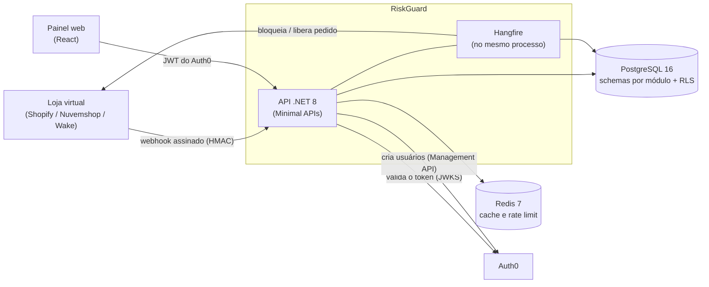
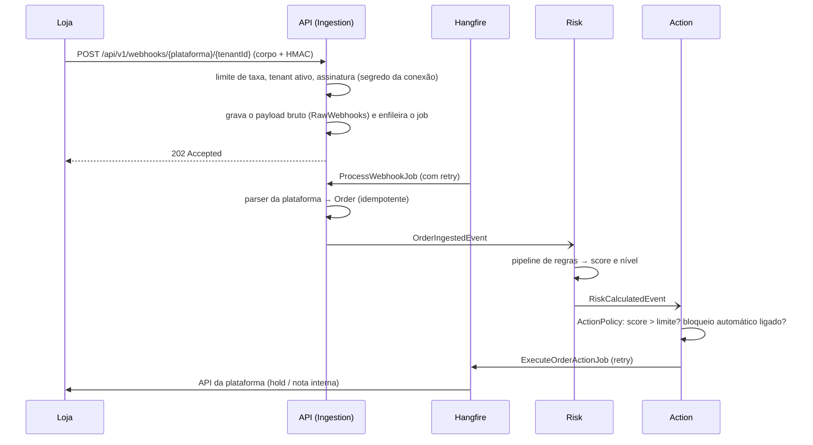

# Arquitetura

## 1. Visão geral



A API e o servidor de jobs rodam **no mesmo processo** (`Hangfire:ServerEnabled`). O Hangfire guarda a fila no PostgreSQL, então várias réplicas da API dividem o trabalho sem coordenação extra.

## 2. Monolito modular

```
src/
  RiskGuard.Api/             composition root: Minimal APIs, middlewares, CLI (--migrate, --provision-tenant)
  RiskGuard.Core/            abstrações e contratos compartilhados (Result<T>, eventos, comandos entre módulos)
  RiskGuard.Infrastructure/  EF Core base, Redis, Hangfire, Auth0, criptografia AES-GCM, tenancy
  Modules/
    RiskGuard.Modules.Tenant/      lojistas, configurações, conexões com plataformas, auditoria
    RiskGuard.Modules.Ingestion/   webhooks: assinatura, parsers, persistência idempotente, processamento
    RiskGuard.Modules.Risk/        motor de regras, avaliações, histórico do comprador
    RiskGuard.Modules.Action/      decisão e execução (bloquear, sinalizar, liberar) nas plataformas
```

**Regra de dependência:** um módulo referencia só `Core` e `Infrastructure`, **nunca outro módulo**. Isso é garantido por um teste de arquitetura (`ModuleBoundariesTests`). Os módulos conversam por **contratos do `Core`** via MediatR:

| Contrato (`Core/Contracts`) | Quem envia | Quem atende |
| --- | --- | --- |
| `OrderIngestedEvent` | Ingestion | Risk |
| `RiskCalculatedEvent` | Risk | Action |
| `GetTenantSnapshotQuery` (limite, bloqueio automático, ativo) | Ingestion, Risk, Action, API | Tenant (cache no Redis) |
| `GetPlatformCredentialsQuery` | Ingestion, Action | Tenant |
| `RecordAuditEventCommand` | Action, Tenant | Tenant |
| `CustomerAnonymizationRequested` | Tenant | Ingestion, Risk |
| `ListTenantIdsQuery` | jobs de retenção | Tenant |

Cada módulo tem o próprio `DbContext` e o próprio **schema** no PostgreSQL (`tenant`, `ingestion`, `risk`, `action`), mais o schema do Hangfire.

## 3. Fluxo de um pedido



Pontos importantes:

- **Resposta rápida:** a API só valida e grava; o cálculo e a ação rodam em segundo plano. Responde `202` assim que o payload bruto e o job estão persistidos.
- **Idempotência:** o pedido é único por `(TenantId, Platform, ExternalOrderId)`. Reenvio do mesmo webhook não duplica pedido nem avaliação. A ação é única por avaliação.
- **Retry:** falhas transitórias (rede, 5xx, 429 da plataforma) repetem até `Hangfire:MaxRetryAttempts` (5). Falhas permanentes viram estado final com a mensagem em `LastError`.
- **Webhook sem dados do pedido** (Nuvemshop e Wake enviam só o id): o job busca o pedido na API da plataforma com o token do lojista (`webhook.needs_order_fetch`) e o resultado passa pelo mesmo parser.
- **Notificações que não são pedido novo** (ex.: Wake, mudança de situação): o parser devolve `webhook.ignored` e o webhook é dado como processado, sem avaliar e sem falha.

### Motor de risco (Pipes and Filters)

Cada regra (`IRiskRule`) contribui com pontos; o score é a soma limitada a 100.

| Regra | Pontos |
| --- | --- |
| `SuspiciousEmailRule`: e-mail com termo suspeito (`fraude`, `fraud`, `golpe`, `golpista`, `scam`) ou domínio descartável (`mailinator.com`, `guerrillamail.com`, `10minutemail.com`, `tempmail.com`, `yopmail.com`, `trashmail.com`) | 50 |
| `HighOrderValueRule`: valor ≥ 5.000 / ≥ 10.000 | 10 / 20 |
| `RefundHistoryRule`: reembolsos anteriores do comprador | 10 por reembolso, máx. 40 |

**Nível de risco** (`RiskLevelClassifier`), com `L` = limite de risco alto do lojista (padrão 80):

- **Alto:** `score > L` (estritamente maior).
- **Médio:** `score > 0` e `score ≥ L / 2` (divisão inteira).
- **Baixo:** o restante.

**Decisão de ação** (`ActionPolicy`): só age em lojista ativo e com `score > L`. Com **bloqueio automático ligado** → bloqueia; desligado → só registra a recomendação (`Skipped`).

### Ações por plataforma

| Plataforma | Ação | Como |
| --- | --- | --- |
| Shopify | **Block** | Coloca as *fulfillment orders* abertas em *hold* (motivo `high_risk_of_fraud`). Liberar usa `release_hold`. Token no header `X-Shopify-Access-Token`. |
| Nuvemshop | **Flag** | A API não tem *hold* e cancelar seria destrutivo; acrescenta a nota interna `[RiskGuard]` ao pedido, preservando a nota que já existir. Liberar remove só essa marca. |
| Wake | (nenhuma) | A Wake não tem "reter pedido" na API pública; o único caminho é o antifraude personalizado, que exige pagamento em duas etapas e outra integração. Por isso, hoje o RiskGuard **só avalia e recomenda**: a decisão de bloquear vira `Skipped` com a explicação. |

Em plataformas **com** bloqueio, sem **token de acesso** na conexão (ou sem conexão), a ação termina em `Failed` (erro permanente, sem chamar a loja). Para só **avaliar**, mantenha o bloqueio automático desligado: a decisão vira `Skipped` e nenhuma chamada é feita.

Estados da ação: `Pending`, `Succeeded`, `Failed`, `Skipped`, `Releasing`, `Released`, `ReleaseFailed`. A liberação é assíncrona (a API responde `202` com `Releasing`).

## 4. Multi-tenancy e isolamento

Três camadas, todas ativas ao mesmo tempo:

1. **Token:** o claim com namespace (`Identity:TenantClaim`, padrão `https://riskguard.app/tenant_id`) é convertido no claim interno `tenant_id`. Um `tenant_id` "cru" que já venha no token é removido; valores inválidos ou conflitantes são recusados.
2. **EF Core:** *Global Query Filter* por `TenantId` em toda entidade `ITenantEntity`. Sem tenant no contexto, nenhuma linha casa (fail-closed).
3. **PostgreSQL (RLS):** o `TenantSessionInterceptor` grava `app.current_tenant` na sessão a cada conexão aberta (inclusive vazio, para nunca reaproveitar o tenant de outra requisição do pool). As policies `tenant_isolation` filtram por esse valor.

**Papéis de banco** (privilégio mínimo):

| Papel | Uso | Observações |
| --- | --- | --- |
| dono (`riskguard`) | só migrations (`--migrate`) | ignora a RLS; **nunca** entregue à API |
| `riskguard_app` | API em runtime | sujeito à RLS; sem superuser |
| `riskguard_jobs` | só o schema do Hangfire | não enxerga dados de módulo |

O `ActiveTenantMiddleware` consulta o snapshot do lojista (cache Redis) em toda requisição autenticada: lojista desativado ou inexistente recebe **403 imediatamente**, sem esperar o token expirar.

## 5. Modelo de dados (resumo)

| Schema | Tabela | Conteúdo |
| --- | --- | --- |
| `tenant` | `Tenants` | lojistas (sem RLS: é o diretório) |
| | `TenantSettings` | limite de risco alto e bloqueio automático |
| | `TenantUsers` | vínculo `sub` do Auth0 ↔ lojista (papel `Owner`) |
| | `PlatformConnections` | conexões; **segredos cifrados** (AES-256-GCM com AAD) |
| | `AuditEvents` | trilha de auditoria **imutável** |
| `ingestion` | `RawWebhooks` | payload bruto e status (`Received`, `Processed`, `Failed`) |
| | `Orders` | pedidos normalizados (e-mail do comprador, valor) |
| `risk` | `RiskEvaluations`, `RiskFactors` | avaliações imutáveis e fatores (motivo e pontos) |
| | `CustomerHistories` | total de reembolsos por comprador |
| `action` | `OrderActions` | ações, tentativas e último erro |
| `hangfire` | (do Hangfire) | filas e jobs |

Toda tabela de módulo, exceto `Tenants`, tem `TenantId` e RLS. Detalhes de colunas: [SDD, seção 7](../spec/SDD.md).

### Auditoria imutável

`AuditEvents` registra **quem, o quê, em quê e quando** (`ActorId` = `sub` do token ou `system`). O papel da aplicação só tem `SELECT`, `INSERT` e `DELETE`; a policy de `DELETE` só enxerga eventos com **mais de 180 dias**. Mudanças do módulo Tenant gravam o evento na mesma transação; operações cruzando módulos (liberar pedido) e a anonimização gravam **antes** de efetivar (falhou a auditoria, a operação falha). Nunca entram segredos nem e-mails de compradores.

## 6. Segurança em camadas

| Tema | Como |
| --- | --- |
| Webhooks | HMAC-SHA256 do corpo cru com o segredo **da conexão do lojista** (Shopify: base64 em `X-Shopify-Hmac-SHA256`; Nuvemshop: hex ou base64 em `x-linkedstore-hmac-sha256`). A **Wake não assina**: o lojista cadastra o cabeçalho `X-RiskGuard-Token` e o valor é comparado em tempo constante (mais fraco que HMAC, mas o corpo da Wake é só um número e os dados vêm da API dela). Sem segredo cadastrado, o webhook é recusado (fail-closed). |
| Segredos de plataforma | AES-256-GCM com dados associados (tenant e plataforma); chave em `Security:EncryptionKey`. Nenhuma resposta da API devolve segredos. |
| SSRF | O domínio Shopify é validado (`*.myshopify.com`) e o id Nuvemshop precisa ser numérico antes de montar qualquer URL de saída. |
| Tokens | JWT RS256 validado por `Authority`/JWKS; algoritmos simétricos e `alg: none` recusados; audiência obrigatória; tolerância de relógio de 30 s. |
| Borda HTTP | Cabeçalhos de segurança, HSTS (ano, subdomínios), CORS fechado por padrão, `X-Forwarded-*` só com `Proxy:*` configurado, tratamento genérico de exceções (sem stack trace). |
| Taxa | Redis: limite por IP (padrão 100/min), por IP nas rotas de webhook (3000/min) e por lojista na ingestão (600/min). Sem Redis, o limitador libera (fail-open) e registra aviso. |
| Dependências | `NuGetAudit` (inclui transitivos) quebra o build com vulnerabilidade moderada ou pior; `npm audit` no CI; Dependabot e CodeQL. |
| Privacidade (LGPD) | Retenção do payload bruto (30 dias), anonimização sob demanda, e-mail nunca em logs ou auditoria. |

Detalhes das decisões: [SDD, seções 4.3 a 4.7](../spec/SDD.md).

## 7. Identidade

A API não tem login, senha nem MFA: tudo isso é do **Auth0**. O RiskGuard valida o token e vincula o usuário ao lojista pelo claim. Cadastro de lojista é uma **operação do dono da plataforma** pela CLI (`--provision-tenant`), com compensação: se a gravação no banco falha depois de criar o usuário no Auth0, o usuário é removido. Guia completo: [`docs/auth0-setup.md`](../auth0-setup.md).

## 8. Padrões de projeto usados

- **Template Method + Strategy:** parsers de webhook, verificadores de autenticidade (HMAC ou token compartilhado), buscadores de pedido e bloqueadores por plataforma (`IWebhookParser`, `IWebhookSignatureVerifier`, `IPlatformOrderFetcher`, `IOrderBlocker`). Uma plataforma nova é um conjunto desses adaptadores mais uma entrada no `PlatformCatalog`.
- **Catálogo de plataformas** (`PlatformCatalog`, no Core): fonte única do que a interface precisa saber (nome, rótulo do identificador, se exige token, se tem ação). O painel lê `GET /api/v1/platforms` e monta o formulário de conexão, sem lista fixa no frontend.
- **Pipes and Filters:** regras de risco (`IRiskRule`).
- **CQRS e eventos:** MediatR; notificações com semântica *at-least-once* (handlers idempotentes).
- **Result<T>:** erros de negócio com `ErrorType` (Validation, Unauthorized, Forbidden, NotFound, Conflict, RateLimited, Unavailable) convertidos em ProblemDetails.
